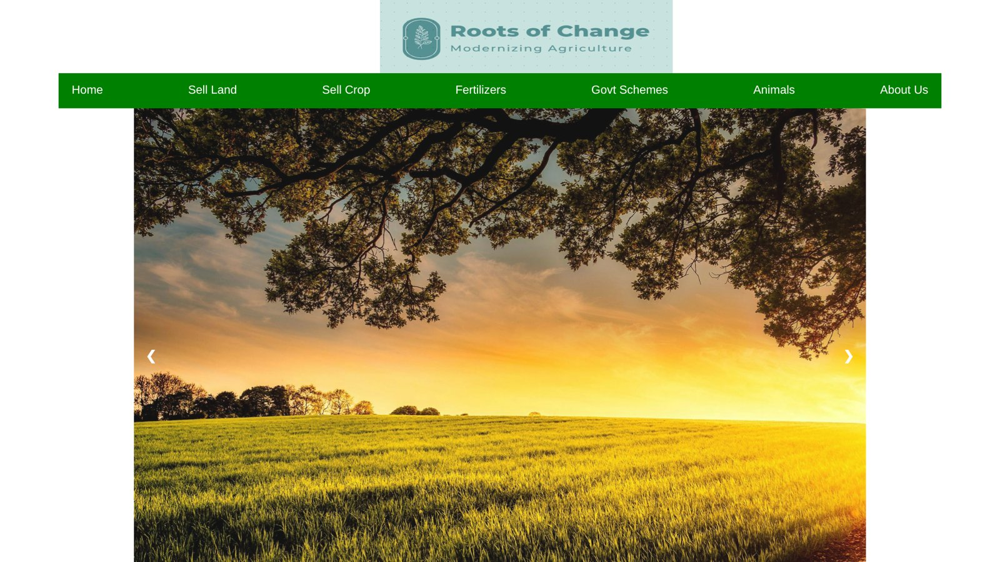
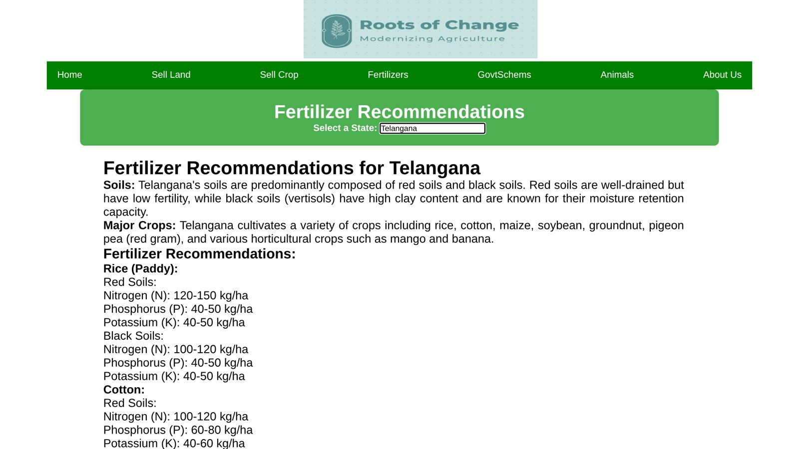
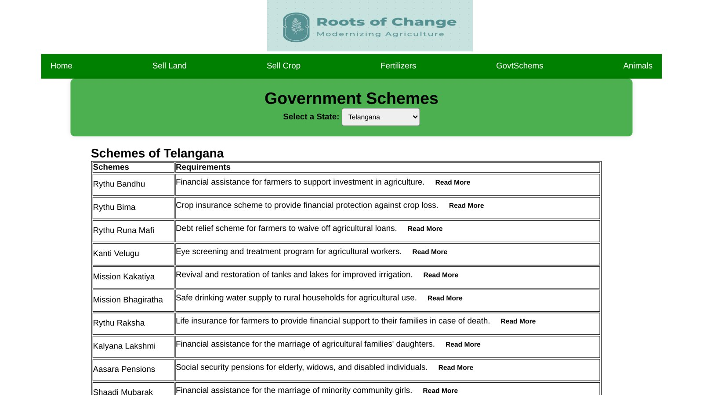
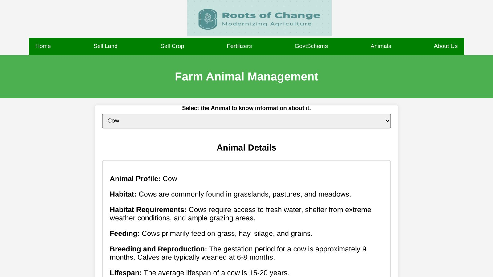
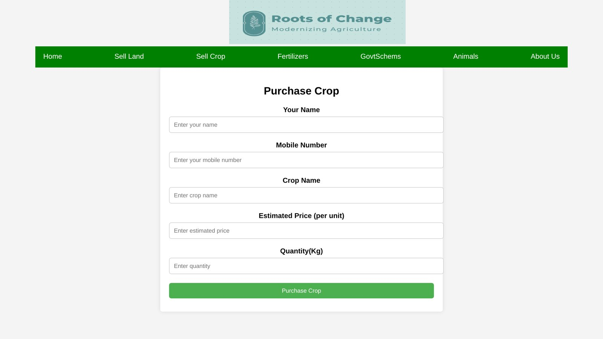
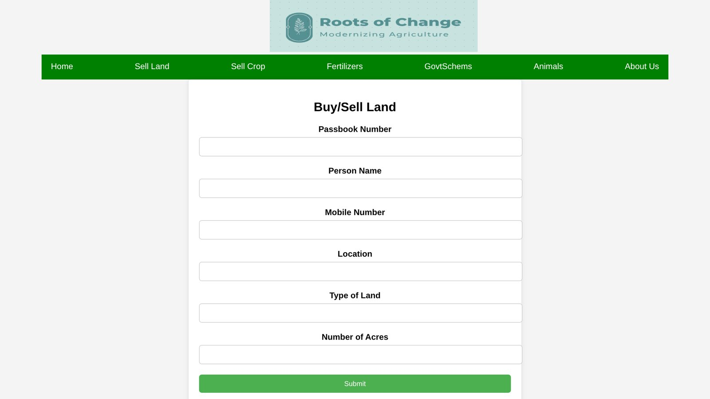
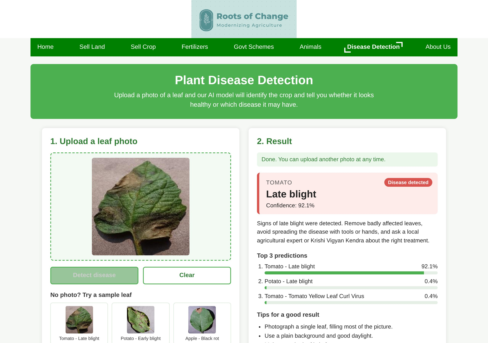
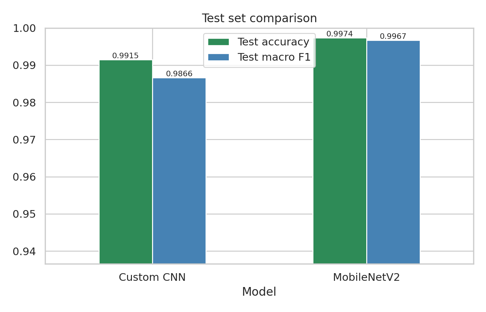
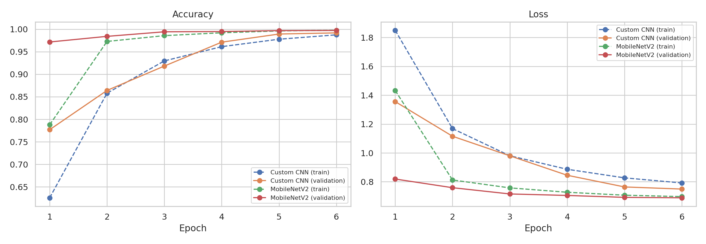

# Roots of Change: Modernizing Agriculture

A website that brings together practical information for farmers in India: fertilizer recommendations by state, government schemes, farm animal care, simple forms to list crops and land for sale, and an AI tool that detects plant diseases from a photo of a leaf.

**Live demo:** https://nadeem-coder28.github.io/Roots-of-change/

**Plant disease detection:** https://nadeem-coder28.github.io/Roots-of-change/DiseaseDetection.html

*Academic project at Bennett University (2024) aimed at modernizing agriculture by giving farmers easy access to practical information and services in one place.*

## Problem

Many farmers lack easy access to reliable agricultural information. The project focuses on five problems:

- limited knowledge of correct fertilizer use for their soil and crops
- low awareness of government schemes that could support them
- uncertainty about where and how to sell crops and land
- difficulty choosing suitable crops for their region and soil
- difficulty recognising crop diseases early, before they spread

## Features

- **Fertilizers:** explains the effects of using the wrong type or quantity of fertilizer, and gives state-wise recommendations (soil types, major crops and nitrogen-phosphorus-potassium doses in kg/ha) for most Indian states.
- **Government schemes:** select a state to see a table of state schemes with their purpose and eligibility.
- **Sell crop:** a form to list a crop (name, mobile number, crop, estimated price, quantity) with input validation; listings are saved in the browser and shown on the page.
- **Buy/sell land:** a form to list land (passbook number, name, mobile number, location, land type, acres).
- **Farm animals:** care profiles for eight animals (cow, buffalo, goat, sheep, pig, pigeon, dog, cat) covering habitat, feeding, breeding, lifespan and healthcare.
- **Plant disease detection (AI):** upload or drag in a photo of a leaf and a convolutional neural network (CNN) identifies the crop and whether the leaf is healthy or which disease it shows, with a confidence score and the top 3 predictions. It covers 38 classes from 14 crops. The model runs in the browser, so photos are not uploaded anywhere. Sample leaves are included for trying it out.
- **About us:** project and contact information.

## Screenshots

| Home | Fertilizer recommendations |
|---|---|
|  |  |
| **Government schemes** | **Farm animals** |
|  |  |
| **Sell crop** | **Buy/sell land** |
|  |  |

**Plant disease detection**



## Plant disease detection model

The notebook [`plant-disease-model/Plant_Disease_Detection_CNN.ipynb`](plant-disease-model/Plant_Disease_Detection_CNN.ipynb) contains the full pipeline: data preparation, training, evaluation and export for the website. It was run on a GPU with PyTorch.

- **Data:** the PlantVillage dataset (colour images): 54,305 photos of single leaves in 38 classes, covering healthy and diseased leaves of 14 crops (apple, blueberry, cherry, corn (maize), grape, orange, peach, bell pepper, potato, raspberry, soybean, squash, strawberry and tomato). Each class was split into 80% training (43,445 images), 10% validation (5,430) and 10% test (5,430).
- **Models:** two CNNs were trained on the same data and compared:
  - **Custom CNN**, built from scratch: five blocks of two 3×3 convolutions with batch normalization and ReLU, each followed by max pooling, then global average pooling, dropout and a linear output layer.
  - **MobileNetV2**, pretrained on ImageNet and fine-tuned on PlantVillage (transfer learning).
- **Training:** 224×224 input images; augmentation with random crops, flips, rotations and colour changes; AdamW optimizer with a one-cycle learning-rate schedule, label smoothing and mixed precision; 6 epochs with batch size 64. For each model, the weights with the best validation accuracy were kept.
- **Deployment:** the model with the higher validation accuracy was exported to ONNX (9.1 MB) and runs on the page with ONNX Runtime Web. The page resizes the photo to 224×224 and normalizes it in the same way as during training.

### Results

Test set: 5,430 images not used for training or model selection.

| Model | Parameters | Best validation accuracy | Test accuracy | Test macro F1 |
|---|---|---|---|---|
| Custom CNN | 2.36 M | 99.19% | 99.15% | 0.9866 |
| MobileNetV2 | 2.27 M | 99.72% | 99.74% | 0.9967 |

The website uses **MobileNetV2**.

| Test set comparison | Training curves |
|---|---|
|  |  |

The per-class classification report, confusion matrix and training history are in [`plant-disease-model/results`](plant-disease-model/results).

PlantVillage photos were taken under controlled conditions (one leaf, plain background), and the test images come from the same dataset, so these numbers describe performance on similar photos. Accuracy on photos taken in the field is expected to be lower.

## Tech stack

- HTML, CSS and JavaScript (no frameworks)
- PyTorch and torchvision for training the CNNs; scikit-learn, pandas and matplotlib for evaluation
- ONNX and ONNX Runtime Web for running the model in the browser
- Browser `localStorage` for crop and land listings
- `about.php`: a PHP script for sending contact messages by email (needs a PHP server, so it is not active on GitHub Pages)

## Run locally

Download or clone the repository and start a local web server in the project folder (the disease detection page loads the model file, which browsers block when a page is opened directly from disk):

```bash
python -m http.server 8000
```

Then open http://localhost:8000 in a web browser.

To retrain the model, run the notebook in `plant-disease-model/` on Kaggle or Google Colab with a GPU, then copy `plant_disease_model.onnx` and `classes.json` from its results into `model/`.

## Limitations

- This is a static website: the fertilizer and scheme information is written into the pages and was collected in 2024, so it may be out of date. Official sources should always be checked.
- Crop and land listings are stored only in the visitor's own browser; there is no shared database or backend.
- The disease detector only knows the 38 PlantVillage classes. A leaf from another crop or with another disease will still be matched to one of these classes, so a low confidence score should be treated as "unknown".
- The detector was trained on photos of single leaves on plain backgrounds and is less reliable on field photos. Its result is an estimate and does not replace advice from an agricultural expert.
